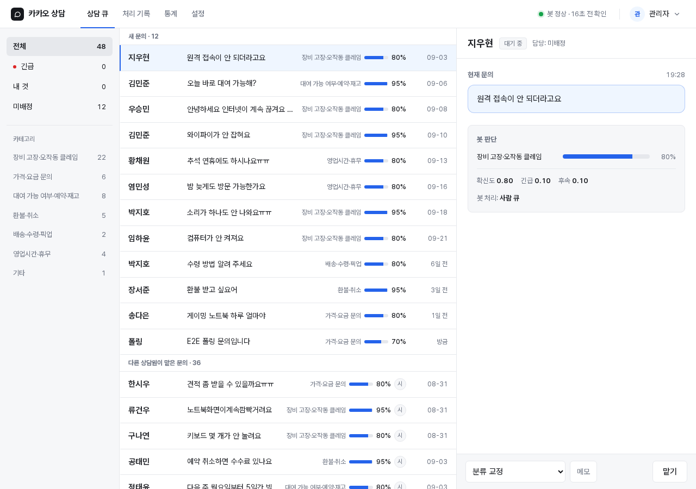

# kakao-cs-jev

카카오톡 채널 1:1 문의를 분류해, 정해진 답이 있는 문의에는 템플릿으로 답하고 나머지는 사람에게 넘기는 상담 자동화입니다.

**상태**: 의뢰를 받아 개발했고, 지금은 실사용을 준비하고 있습니다(데모 모드).
PC 대여 매장의 상담 채널을 가정한 카테고리 8종으로 구성했습니다.
공개본에서는 의뢰처를 알 수 없도록 채널·계정 정보를 치환했고, 개발 이력은 커밋 하나로 합쳤습니다.



## 처리 흐름

```
카카오비즈니스 관리자 웹
   │  Playwright(봇 전용 계정 · 영속 프로필 · 허용된 방만 연다)
   │  처리할 방은 PostgreSQL FOR UPDATE SKIP LOCKED로 원자 점유
   ▼
읽기 ─ 채팅 목록은 「미답변 신호」로만 쓰고 본문은 방 DOM에서 읽습니다
   │  나눠 보낸 메시지는 45초 정적 윈도우로 한 건으로 합칩니다
   ▼
분류 ─ Jev(TypeSafe System One API)
   │  Choice = 카테고리 · Noul = 긴급/환불 · 후속 질문 여부 · confidence
   ▼
판정 decide()
   ├─ 확신도 ≥ 0.9 이고 자동응답이 허용된 카테고리 ── 템플릿 자동응답(at-most-once)
   ├─ 광고·스팸으로 확신하는 경우 ─────────────── 무음 보관
   └─ 그 밖 ─ 사람 검수 큐(PostgreSQL)
                + Discord 알림(분류 요약과 큐 링크만 보냅니다)
   ▼
상담 웹(Next.js) ─ 맡기 · 완료 · 분류 교정 · 메모
   ▼
통계 ─ 봇 분류와 상담원 교정의 일치율 → 자동응답 임계값과 카테고리 조정
```

- 템플릿에 `[자리표시자]`가 남아 있으면 확신도가 높아도 보내지 않고 사람 큐로 넘깁니다.
- 카카오에서 사람 상담원이 직접 답하면 그 방의 열린 문의를 닫습니다(봇 계정의 보낸이 표기로 구분합니다).
- 운영 규칙은 초안 모드(`DRAFT=1`, 알림만 보내고 전송하지 않음)로 2주간 정확도를 잰 뒤 자동 전송을 켜는 것입니다.

## 안전장치

- **개인정보 마스킹**: 전화·이메일·카드·계좌·주민번호를 밖으로 나가는 텍스트(Jev 입력·알림)에서 가립니다. DB에는 주민번호·카드번호만 가려 저장합니다. 우회 형식(전각 문자·제로폭 문자·여러 구분자·국제 번호 형식 등)은 테스트로 고정했고, 규칙을 넓힐 때는 기점 대비 차분 테스트(`test/mask-diff.test.ts`)를 통과해야 합니다.
- **세션 폐기**: 서명 쿠키는 매 요청 사용자 행과 대조합니다. 로그아웃·비밀번호 변경·초기화·비활성화를 하면 그 사용자의 기존 쿠키가 다음 요청부터 끊깁니다.
- **기본 거부**: 공개 경로 목록 밖은 모두 인증이 필요합니다. 새 라우트는 권한 매트릭스 테스트(`web/test/authz-matrix.test.ts`)가 자동으로 검사합니다.
- **로그인 리밋**: 이메일+출처 쌍과 출처 단위로 실패를 셉니다. bcrypt 동시 실행 수에도 상한을 둡니다. 실패 로그인은 감사 로그에 남깁니다.
- **보존 익명화 배치**: 보존 기간이 지난 문의 원문·고객명·메모를 하루 한 번 비웁니다. 방 키는 해시로만 저장합니다.
- **컨테이너**: bot·web 모두 `cap_drop: ALL`·`no-new-privileges`·비루트로 돕니다. bot은 Chromium 샌드박스를 켜고 Docker 기본값에 user namespace 규칙 하나만 더한 seccomp 프로필로 실행합니다. web은 슈퍼유저가 아닌 전용 DB 롤로 접속하고, 방 테이블에는 열 단위 권한만 받습니다. 이 설정은 `test/container-security.test.ts`가 고정합니다.
- **알림 최소화**: Discord에는 고객 이름·문의 원문을 싣지 않습니다. 보존 기간 밖에 개인정보가 쌓이지 않게 하고, 고객 텍스트로 알림을 위장할 수 없게 하기 위해서입니다.

## 검증

- 테스트: `node:test` 봇 88건 + 웹 102건(embedded PostgreSQL, 빌드된 Next 서버를 띄운 통합·E2E 포함). 이 공개본에서도 전부 통과합니다.
- 리뷰: 5모델 병행 보안 리뷰(2026-09-26)와 외부 공개 전 3모델 × 2패스 리뷰(전체·보안, 2026-09-29)를 했습니다. 치명 항목은 0건이었고, 나온 주의 항목은 처리 원장으로 추적해 수정했습니다. → `docs/review/`
- 분류: PC 대여 시나리오 17건 중 16건이 정답이었습니다. 오답 1건은 확신도 0.59라 사람 큐로 넘어갔습니다. 긴급·환불 판정 문구를 도메인에 맞추자 「반납」 문의가 환불로 잡히던 점수가 0.61에서 0.06으로 내려갔습니다.

## 구조

```
src/          봇: loop(실물 연결) · tick(폴링 한 바퀴) · handle(방 하나) · kakao/kakao-dom(Playwright·DOM 파서)
              classify(Jev) · store(postgres) · mask · notice/notify(Discord) · retention(익명화)
web/          Next.js App Router 상담 웹: /queue · /log · /stats · /settings
db/migrations 번호 순 SQL(+ 데이터 변환 .ts)
test/         봇 테스트 · 실물 방 DOM 픽스처(이름 마스킹)
docs/         설계 명세 · 리디자인 · 리뷰 리포트 · 화면 캡처
```

설계 결정과 실행 명령은 `CLAUDE.md`에 있습니다. 개발 기록은 `PROGRESS.md`, 계획은 `PLAN.md`에 있습니다.
두 문서는 사람 감독 없이 도는 개발 루프가 남긴 기록입니다.

## 실행

```
# 비밀값: docs/env.example의 네 파일을 ~/.claude/ 아래에 둡니다(권한 600)
docker compose build && docker compose run --rm bot npx tsx scripts/login.ts   # 첫 로그인 → browser-data/
set -a; . ~/.claude/kakao-cs.env; set +a
docker compose up -d                                                           # db → migrate → bot · web(127.0.0.1)
docker compose run --rm migrate node --import tsx scripts/create-user.ts <email> <이름> admin

scripts/test.sh                       # 전체 테스트(봇 → 디자인 게이트 → web 빌드·테스트)
scripts/web-smoke.sh --seed           # 시드 300건으로 상담 웹만 띄워 보기(카카오·Jev 없이)
```

카카오비즈니스 space·채널 ID는 공개본에서 `000000`·`_XXXXX`로 치환했습니다.
실제로 쓰려면 `src/handle.ts`·`src/kakao.ts`·`web/lib/kst.ts`·`scripts/`의 URL 상수와 `docker-compose.yml`의 `CHANNEL_NAME`·`BOT_SENDER`를 바꿔야 합니다.

## 스택

Node 22 · TypeScript(tsx) · Playwright · PostgreSQL(`pg`, ORM 없음) · Next.js 16 · iron-session · zod · Docker Compose · `@typesafe-ai/sdk`(Jev)
